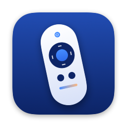
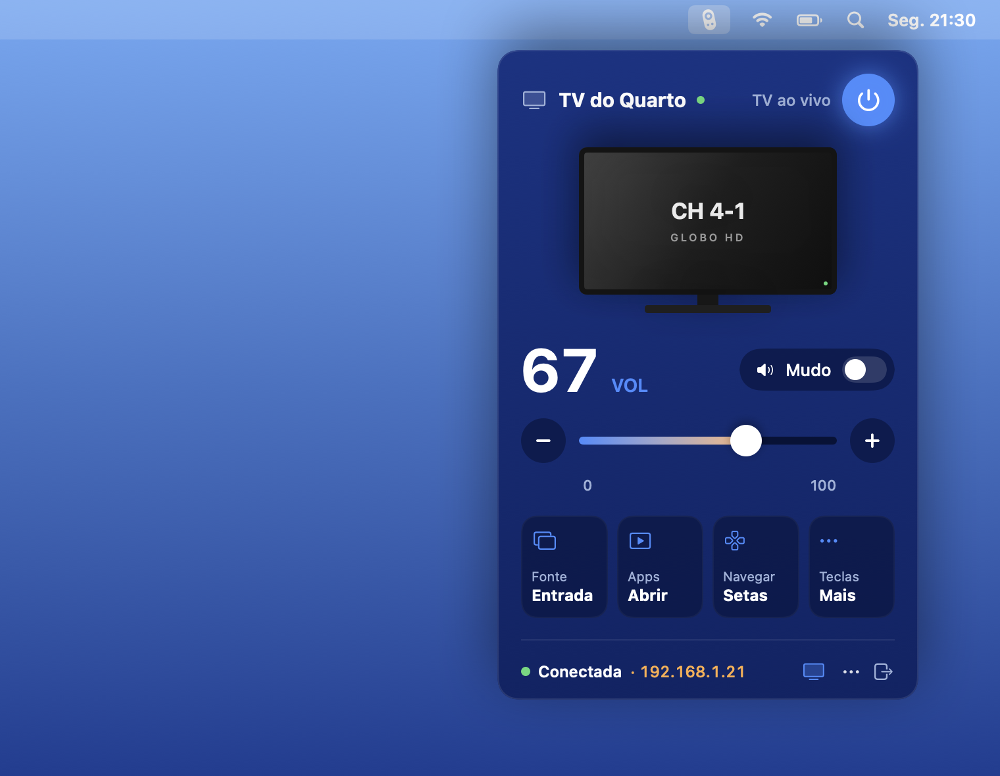
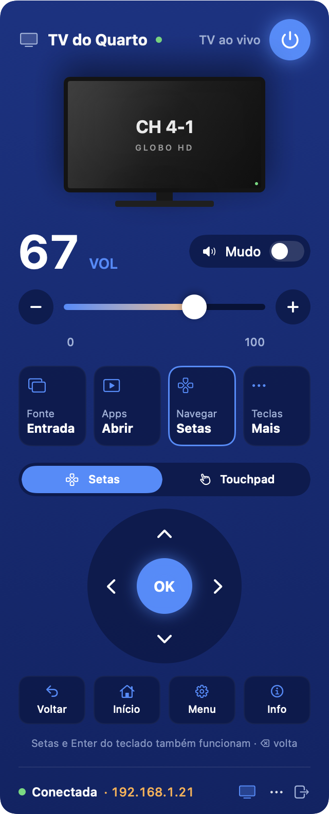
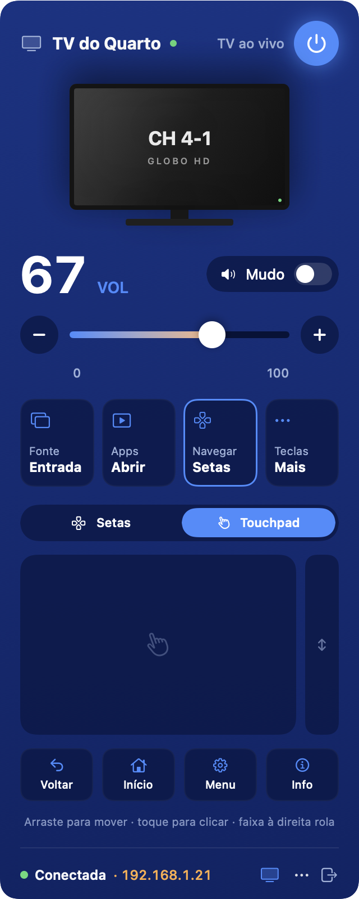
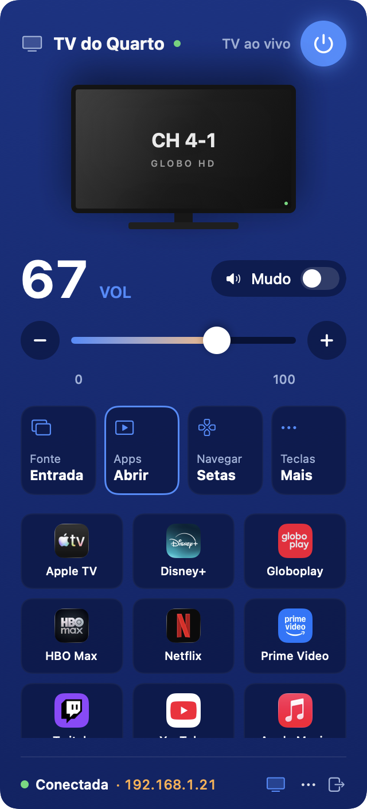
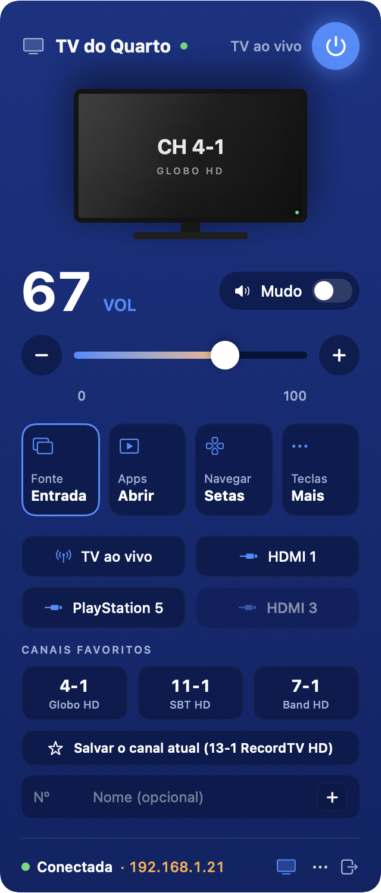
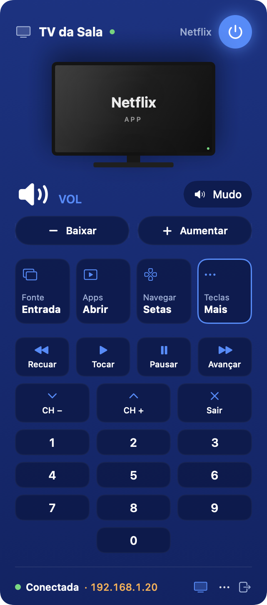
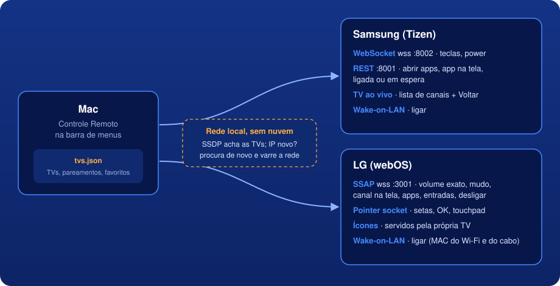
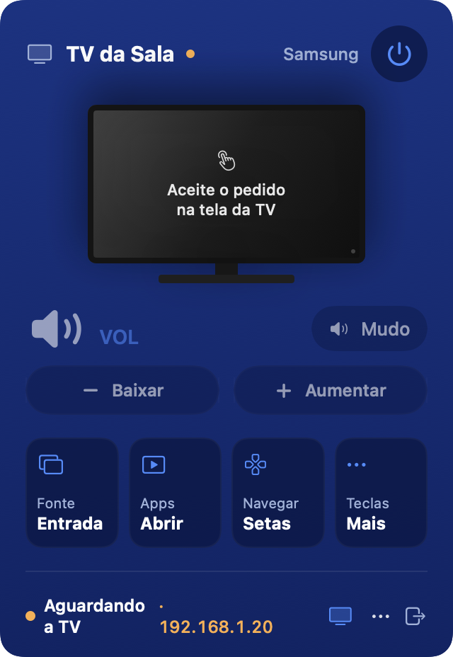

<p align="center">
  
</p>

<h1 align="center">Controle Remoto</h1>

<p align="center">
  Controle remoto das TVs da casa na barra de menus do Mac.<br>
  Samsung (Tizen) e LG (webOS), direto pela rede local, sem nuvem e sem conta.
</p>

<p align="center">
  
</p>

## O que ele faz

- **Liga e desliga** a TV (desliga pela rede; liga com Wake-on-LAN)
- **Volume**: na LG, o número exato com slider e mudo; na Samsung, +/− e mudo
- Mostra **o que está na tela**: o canal (ex.: "CH 4-1 · Globo HD") ou o app aberto
- **Apps**: lista os apps instalados, com os ícones, e abre com um clique
- **Entradas**: TV ao vivo, HDMI 1, HDMI 2…
- **Canais favoritos**: um clique e a TV vai para o canal
- **Setas, OK, Voltar, Início, Menu**, controles de mídia, canal +/− e teclado numérico
- **Touchpad** para o cursor da LG, como o Magic Remote
- **Várias TVs**: troca pelo ícone de TV no rodapé do painel
- **⌥⌘R** abre o painel de qualquer lugar; com ele aberto, as setas, o Enter e o ⌫ do Mac
  controlam a TV, e (opcional) as teclas de volume e mídia também

| Setas | Touchpad (LG) | Apps | Entradas e favoritos | Mais teclas |
|:---:|:---:|:---:|:---:|:---:|
|  |  |  |  |  |

## Como funciona

<p align="center">
  
</p>

O app conversa direto com cada TV pela rede de casa, com os mesmos protocolos que os apps
de celular das fabricantes usam:

| | Samsung (Tizen, 2016+) | LG (webOS) |
|---|---|---|
| Descoberta | SSDP + `http://IP:8001/api/v2/` | SSDP (servidor `WebOS`) |
| Teclas | WebSocket `wss://IP:8002` (`samsung.remote.control`) | Socket de "pointer" do webOS |
| Volume | Teclas +/− | Valor exato, atualizado em tempo real |
| Apps | API REST (`POST :8001/api/v2/applications/<id>`) | `ssap://system.launcher/launch` |
| Na tela | App visível, pela API REST | Canal ou app, em tempo real |
| Pareamento | Pedido na tela da TV → token | Pedido na tela da TV → client-key |
| Ligar | Wake-on-LAN, ou a tecla de power se estiver em espera | Wake-on-LAN (MAC do Wi-Fi e do cabo) |

**Pareamento.** Na primeira conexão a TV mostra um pedido de permissão; aceite com o controle
físico (uma vez só). O token fica salvo no Mac e a TV não pergunta de novo.

<p align="center">
  
</p>

**Continua funcionando sozinho.**
- Abre ao iniciar sessão (dá para desligar no menu ⋯).
- Reconecta quando o Mac acorda e quando a rede volta ou muda.
- A TV é identificada pelo UUID, não pelo IP. Se o roteador trocar o IP dela, o app procura de
  novo por SSDP; se o roteador filtrar multicast, varre a sub-rede. O pareamento continua valendo.
- Enquanto a TV está desligada, tenta de novo a cada 30 s (para perceber quando alguém liga pelo
  controle físico); um ping a cada 20 s derruba conexões mortas.

### Particularidades das Samsung recentes

Testado numa Samsung BU8000 (2022):

- O WebSocket aceita teclas, mas ignora os comandos de listar e abrir apps. O app abre apps pela
  API REST e monta a lista consultando IDs de apps conhecidos: só aparecem os instalados, com o
  nome que a TV informa. Os ícones vêm da App Store (busca pelo nome, guardados em cache); os da
  LG vêm da própria TV.
- `KEY_TV`, `KEY_DTV` e `KEY_ANTENA` não fazem nada. O botão **TV ao vivo** abre a lista de canais
  (que leva à TV ao vivo, antena e Samsung TV Plus juntos) e fecha a lista com o Voltar. Os
  favoritos fazem isso e digitam o número do canal.
- Com soundbar (HDMI/óptico), a TV só repassa o +/−; o volume exato fica na soundbar e não aparece
  pela rede.

## Instalar

Precisa do macOS 14 ou mais novo e das Command Line Tools (`xcode-select --install`). O Xcode
completo não é necessário.

```bash
git clone https://github.com/marcosznl/controle-remoto.git
cd controle-remoto
scripts/build.sh --install
```

O script compila, monta `dist/Controle Remoto.app`, assina (com o seu certificado Apple
Development, se houver; senão ad-hoc), copia para `~/Applications` e abre.

Na primeira vez:
1. O macOS pede acesso à **Rede Local**: permita (é como o app acha e controla as TVs).
2. Cada TV mostra um pedido de permissão: aceite com o controle da TV.
3. Se o app foi compilado em outro Mac, o macOS bloqueia a primeira abertura: clique com o botão
   direito no app › **Abrir**.

### Ajustes nas TVs

Para ligar pela rede, deixe ativado:
- **Samsung**: Configurações › Geral › Gerenciador de dispositivos externos › *Ligar com dispositivo móvel*
- **LG**: Configurações › Geral › Dispositivos › *Ligar TV via Wi-Fi* (ou *Mobile TV On*)

Na Samsung também dá para desligar o pedido de permissão para aparelhos novos: mesmo menu ›
Gerenciador de conexão de dispositivos › *Notificação de acesso*.

## Usar

| | |
|---|---|
| Abrir/fechar o painel | clique no ícone ou **⌥⌘R** (Esc fecha) |
| Navegar | setas, Enter (OK) e ⌫ (Voltar) do teclado, com o painel aberto |
| Volume e mudo | `+` `-` `m`, ou as teclas do Mac (menu ⋯, pede permissão de Acessibilidade) |
| Trocar de TV | ícone de TV no rodapé |
| Favoritos | aba Entrada: digite o número (e um nome) e clique em **+**; na LG, "Salvar o canal atual". Botão direito remove |
| Encerrar | botão ⇥ no rodapé |

Os dados ficam em `~/Library/Application Support/ControleRemoto/`: `tvs.json` (TVs, tokens de
pareamento e favoritos) e `icones/` (cache dos ícones dos apps). Copiar o `tvs.json` para outro
Mac leva as TVs junto.

## Desenvolvimento

```bash
swift build
.build/debug/ControleRemoto --descobrir             # lista as TVs da rede (--varrer testa a varredura)
.build/debug/ControleRemoto --testar 60             # conecta nas TVs salvas e mostra o que respondem
.build/debug/ControleRemoto --energia quarto ligar  # ou desligar: o mesmo caminho do botão de power
.build/debug/ControleRemoto --canal quarto 4-1      # sem número, lista os canais (LG)
.build/debug/ControleRemoto --tecla KEY_HOME aovivo # teclas para a Samsung (aovivo = botão TV ao vivo)
.build/debug/ControleRemoto --snapshot fotos        # PNGs do painel com TVs de exemplo
.build/debug/ControleRemoto --docs docs             # as imagens deste README
scripts/make-icon.sh                                # redesenha o ícone (desenhado em código)
```

| Arquivo | |
|---|---|
| `StatusController.swift` | ícone na barra, painel (janela própria, opaca), atalho ⌥⌘R |
| `PopoverView.swift` | a interface do painel |
| `TVSession.swift` | a conexão com cada TV: base comum, `SamsungSession` e `LGSession` |
| `RemoteStore.swift` | TVs salvas, descoberta, reconexão e troca de IP |
| `Network.swift` | WebSocket, descoberta (SSDP e varredura) e Wake-on-LAN |
| `MacKeys.swift` | atalho global e teclas de volume/mídia do Mac |
| `IconStore.swift` | ícones dos apps (da TV ou da App Store), com cache em disco |
| `AppIcon.swift` | o ícone do app e o da barra de menus, desenhados em código |

O código não usa `@State` (no macOS atual ele é uma macro que só compila com o Xcode completo);
o estado da tela fica em `ObservableObject`s.

## Licença

[MIT](LICENSE)
